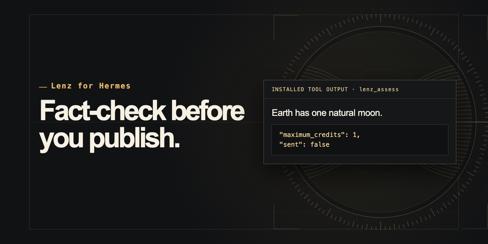
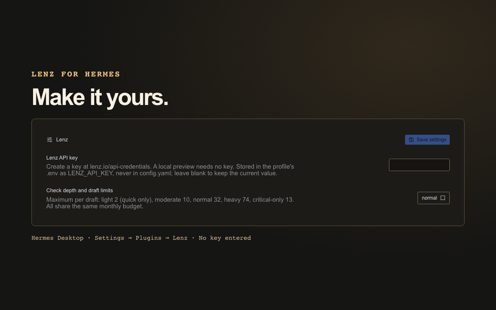

# Lenz for Hermes

**Fact-check the claims you’re about to publish.** Get a quick read on dates, figures, and assertions, or ask Lenz to investigate a disputed claim against sources. Hermes shows you the maximum credit cost before sending the selected material.



## Try it without a key

In a fresh Hermes session with Lenz enabled, ask:

> Preview a quick check of “Earth has one natural moon.” Don’t send it.

Expect a **one-credit maximum** and **nothing sent**. The estimate is local. It is not a fact-check result, and it does not use Lenz credits.

## Install and connect

Lenz is a native Hermes Agent plugin, not an MCP server. It requires Hermes **0.23.2 or newer** and has no extra plugin dependencies. It was tested on macOS with an isolated Hermes profile.

Install the [reviewed release](https://github.com/cygnostik/hermes-lenz/releases/tag/v1.1.0):

```sh
hermes plugins install https://github.com/cygnostik/hermes-lenz --ref v1.1.0 --no-enable
hermes plugins enable lenz
```

Read the custom-source trust prompt. For a named profile, use `hermes -p NAME` for both commands. Start a new session in that profile after enabling the plugin.

1. Create your own key at [Lenz API credentials](https://lenz.io/api-credentials).
2. In Hermes Desktop, open **Settings → Plugins → Lenz**, enter it in **Lenz API key**, and click **Save settings**. Alternatively, use the installer’s masked prompt in your own interactive terminal. If the terminal warns that input may be echoed, skip the prompt. Never paste the key into chat or enter it as a command argument.
3. Ask **“Show my Lenz balance and reset.”** This reads your account usage without submitting a claim or spending Lenz credits. If you replace a rejected key, start a fresh session and check again.



## Pick the smallest check that answers your question

| Ask Hermes | Maximum | What you get |
| --- | ---: | --- |
| “Extract the checkable claims from this paragraph.” | 0 credits | A list of claims, not verdicts. Daily limits apply. |
| “Quick-check these figures.” | 1 per claim | An initial verdict and confidence. Searched pages are not verified citations. |
| “Investigate this disputed claim against sources.” | 6 at low depth or 11 at standard | One assessment plus at most one deep check. |
| “Review this draft and its citations.” | 32 in Normal mode | A bounded review with assessments, conditional deeper checks, and citation checks. |

For any submission, review the selected text or URL, destination, and maximum, then tell Hermes whether to send it. Previews expire after 15 minutes. A changed request needs a new preview. The plugin matches the request to the preview and amount; agreement happens in chat, not through a separate approval dialog.

For a queued review, ask Hermes to check the same job later rather than submit it again. Read the sources and any failed or omitted rows. No public record is not proof a claim is false.

### Draft limits

Choose **Check depth and draft limits** in Lenz’s plugin settings. The maximum is a reservation, not necessarily what Lenz bills. Critical-only is for explicitly high-stakes requests.

| Mode | Quick checks | Deep checks | Citations | Max credits |
| --- | ---: | --- | ---: | ---: |
| Light | 2 | None | 0 | 2 |
| Moderate | 5 | 1 low | 0 | 10 |
| Normal (default) | 10 | 2 standard | 2 | 32 |
| Heavy | 20 | 5 standard | 4 | 74 |
| Critical-only | 3 | 1 standard | 0 | 13 |

## The 500-credit monthly cap

Lenz for Hermes caps **reservations in this profile** at 500 credits per Lenz reset period. It does not grant credits or change your plan. Before sending content, the plugin checks the connected account’s balance, reset date, and prices. A lower balance can tighten the cap for the rest of that period. The cap does not cover spending on the Lenz website, through MCP, or in other profiles.

For example, if 500 credits are available, a conservative allocation is **300 quick claims + 5 Normal draft reviews + 4 Moderate draft reviews** across the period. That is an allocation at maximum cost, not a guarantee of completed checks. With 100 credits available, one Normal review leaves up to 68 for quick checks in that allocation. Check your own allowance with `lenz_usage` or see [Lenz plans](https://lenz.io/plans). Hermes model usage is separate.

The full quoted maximum remains reserved on an ambiguous submission, even if no bill has arrived. Check Lenz activity before starting another request. The ledger survives restarts and reinstallations in the same profile. It opens a new period only after the old reset passes and Lenz reports a later reset.

## Data, updates, and removal

- A local preview does not contact Lenz. If you proceed, the plugin sends the selected material to `https://lenz.io/api/v1`. A public URL asks Lenz to fetch it. Balance and status checks make read requests. See [Lenz privacy](https://lenz.io/privacy).
- The local ledger holds amounts, reset times, request IDs, and expiring preview tags, not claim text, results, or credentials. Hermes can retain conversations and tool results. Reviews request private deep checks and no webhook delivery; private does not mean zero retention. The plugin does not run checks in the background or retry submissions automatically.
- To update, review the new revision and use Hermes’s plugin manager. Calls from older versions that omit the approved maximum now preview only. To disable, run `hermes plugins disable lenz`. To uninstall, run `hermes plugins remove lenz` in the same profile. The ledger is outside the installed plugin, under `lenz-budget/`, so removing the plugin does not reset it. Manage or revoke your key separately.

[License](LICENSE) · [Report an issue](https://github.com/cygnostik/hermes-lenz/issues)
